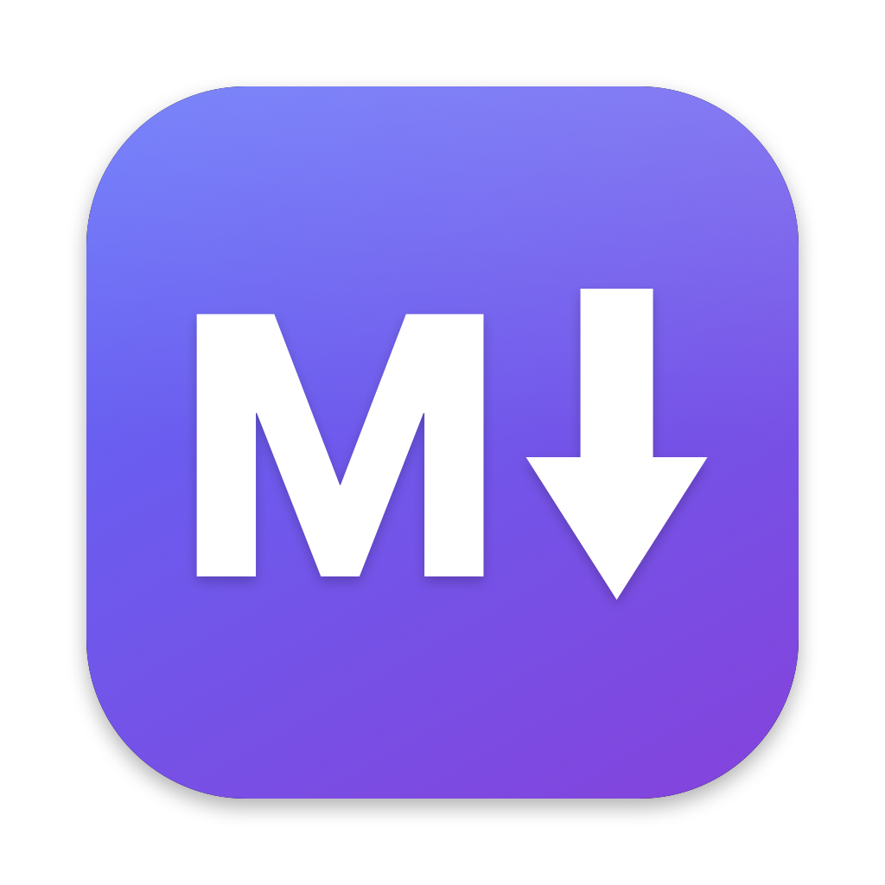
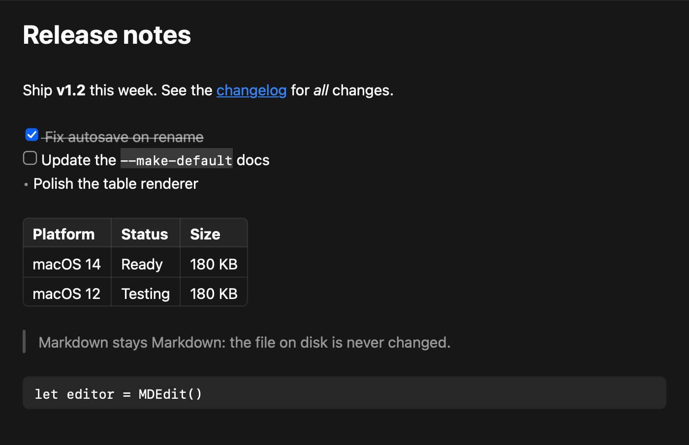
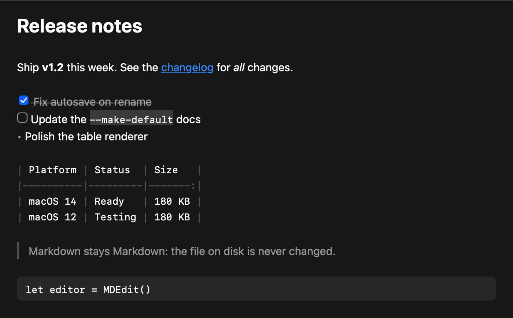

<p align="center">
  
</p>

<h1 align="center">MDEdit</h1>

<p align="center">A tiny, fast, native Markdown editor for macOS.<br>
Double-click a <code>.md</code> file, edit it, close the window. That's it.</p>

<p align="center">
  
</p>

## Why

Most Markdown apps are note-taking systems, Electron apps, or both. MDEdit is just an editor: one window per
file, a ~300 KB binary, no dependencies, no vault, no sync, no telemetry. It is built on AppKit, so it starts
instantly and feels like a Mac app.

## Features

- **Formatted mode** (default), similar to Obsidian's live preview. Markdown syntax is hidden and only shows on
  the line you are editing, so documents read cleanly while staying fully editable.
- **Raw mode**: plain monospaced Markdown, nothing hidden.
- **Tables** render as grids. Click into a table and it switches to raw Markdown so you can edit it.
- **Task lists** render as checkboxes; click one to tick it.
- Headings, bold, italic, strikethrough, inline code, fenced code blocks, links, quotes, bullets and rules.
- **Your file is never rewritten.** Formatting is display only, so what is saved is exactly the Markdown you typed.
  Smart quotes, smart dashes and autocorrect are off.
- Autosave, undo, find and replace, window tabs, dark mode.
- One click to become the **default app for `.md` files**.

<p align="center">
  
  <br><em>Cursor in the table: its Markdown is shown for editing.</em>
</p>

## Install

Requires macOS 12 or later and the Xcode Command Line Tools (`xcode-select --install`).

```bash
git clone https://github.com/j0m1st/md-simple-editor-macos.git
```

```bash
cd md-simple-editor-macos
```

```bash
./build.sh install
```

This builds `MDEdit.app` and copies it to `/Applications`. Run `./build.sh` on its own to build into `build/`
without installing.

## Make it the default for Markdown files

Open MDEdit and choose **MDEdit → Make Default App for Markdown Files**. macOS asks you to confirm; choose
**Use "MDEdit"**. The menu item shows a checkmark once it is the default.

From a terminal:

```bash
/Applications/MDEdit.app/Contents/MacOS/MDEdit --make-default
```

## Shortcuts

| Action | Shortcut |
|---|---|
| Raw Markdown | ⌘1 |
| Formatted | ⌘2 |
| Toggle raw / formatted | ⇧⌘E |
| Bigger / smaller text | ⌘+ / ⌘- |
| Find / find and replace | ⌘F / ⌥⌘F |
| New / open / save | ⌘N / ⌘O / ⌘S |

## How it works

| File | What it does |
|---|---|
| `Sources/main.swift` | App, menus, document (open, save, autosave), default-app handling |
| `Sources/Styler.swift` | Parses Markdown line by line and styles the text in place; decides what is hidden |
| `Sources/TextView.swift` | Custom TextKit 1 layout manager that draws tables, code blocks, quotes and checkboxes |
| `tools/make-icon.swift` | Generates `Resources/AppIcon.icns` (`swift tools/make-icon.swift`) |

Hidden syntax is laid out as zero-width glyphs and table pipes as tab stops, so the underlying text is never
modified. Only the edited lines are restyled while typing, which keeps large files fast.
